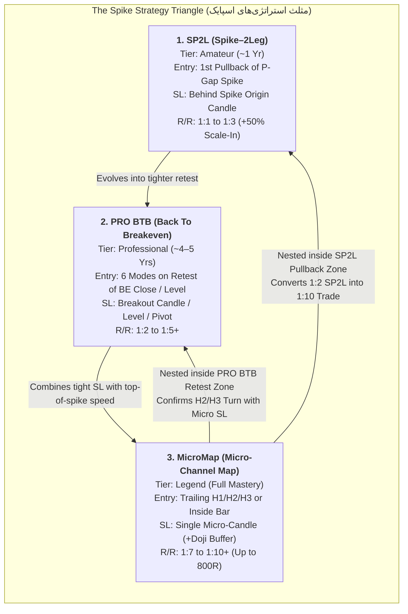

# Unified System & Strategy Architecture Diagrams (`architecture_diagrams.md`)

## 1. End-to-End Autonomous Decision & Execution Pipeline

```mermaid
flowchart TD
    subgraph L0["Layer 0: Horizon, Account & Psychological Kernel (Videos 03, 05, 06)"]
        A0[Start Session / Tick Stream] --> A1{Profile == DAY_TRADER?}
        A1 -->|Yes| A2{Time >= EOD Close?<br/>US30: 22:58 / FX-Gold: 23:55}
        A2 -->|Yes| A3[MANDATORY TEMPORAL STOP-LOSS<br/>Execute Map Manager: Full Close]
        A2 -->|No| A4{Mental State Calm &<br/>Total Risk < 10% Cap?}
        A4 -->|No| A5[Emotional / Risk Circuit Breaker<br/>Lock Profits & Halt New Entries]
    end

    subgraph L1["Layer 1: Temporal Analysis Engine — 'WHEN?' (Video 01)"]
        A4 -->|Yes| B1[Normalize Clock to Broker GMT+3<br/>Session Windows Pro v3.0]
        B1 --> B2{Mins to Next Master Time Point<br/>03,04,08,09,10,16:30,18,20,23 <= 5m?}
        B2 -->|Yes| B3[Gold Countdown Warning!<br/>Block New Entries & Manage Open Trades]
        B2 -->|No| B4[Evaluate Symbol Time Window Grade<br/>Grade A: 10-13, 15:30-18 XAU / 16:30-18 US30]
    end

    subgraph L2["Layer 2: Spatial Memory Engine — 'WHERE?' (Videos 01, 04)"]
        B4 --> C1[Compute 13 Weekly Map Levels + Weekend Gap]
        C1 --> C2[Compute PDH, PDL, Mid, Open, Close<br/>US30: 16:30-23:00 NY Session HL via M15]
        C2 --> C3[Compute 0.5% Auto-Step Round Levels]
        C3 --> C4{At Outer 2.0x / Range Ceiling<br/>with Late-Window Exhaustion Gap?}
        C4 -->|Yes| C5[Switch Context to Reversal:<br/>Exhaustion Gap / 1-2-3 MTR -> NY Close / 50% Mid]
        C4 -->|No| C6[Continuation / Breakout Context Active]
    end

    subgraph L3["Layer 3: Spike-Cycle Price Action Engine — 'HOW?' (Videos 02, 03, 04)"]
        C5 --> D0[Candle-by-Candle Counting inside Active Cycle]
        C6 --> D0
        D0 --> D1{Valid Spike with P-Gap?<br/>L_i+1 > H_i-1 or H_i+1 < L_i-1}
        D1 -->|No| D2[Reject Impulse as Retail Noise]
        D1 -->|Yes| D3{Select Trader Tier & Trigger Mode}
        D3 -->|Tier 1: Amateur| D4[SP2L: 1st Pullback L_t < L_t-1<br/>SL behind Spike Origin | TP 1:1-1:2 | +50% Scale-In]
        D3 -->|Tier 2: Pro| D5[PRO BTB: Breakout -> Return to BE/Level<br/>Modes 1..6 | 3 SL Anchors | TP >= 2R]
        D3 -->|Tier 3: Legend / Nested| D6[MicroMap inside SP2L/BTB Zone:<br/>Entry 1 -> 2 -> 3 or Inside Bar or Opt 1 H2 / Opt 2 H3]
        D6 --> D7{Consecutive SLs >= 3?}
        D7 -->|Yes| D8[HARD 3-STRIKE INVALIDATION<br/>Abort Setup Immediately]
        D7 -->|No| D9[Apply Doji SL Buffer:<br/>Behind Prior Close/Low + 1.5x Spread]
    end

    subgraph L4["Layer 4: Signal Scoring Triad & Map Manager Execution (Videos 01, 02, 03, 05, 06)"]
        D4 --> E1[Score Triad: Time + Level + Price Action]
        D5 --> E1
        D9 --> E1
        E1 --> E2[Map Manager Auto-Lot Calculation<br/>Risk = 0.5% - 2.0% <= Comfort Ceiling]
        E2 --> E3[Execute Order & Start 180s Anti-Arbitrage Hold Timer]
        E3 --> E4{Elapsed Time >= 180s<br/>2-4 Min Broker Rule?}
        E4 -->|No| E5[Hold Position Open<br/>Prevent Latency Arbitrage Flag]
        E4 -->|Yes| E6{Reached 2R / 3R Milestone?}
        E6 -->|Yes| E7[Execute Half Close Insurance 50%<br/>Worst-Case Net >= +0.5R to +1.0R Guaranteed]
        E7 --> E8{1 Min to PMI/News OR<br/>Opposing Pin Bar at Target?}
        E8 -->|Yes| E9[Close 90% Volume -> Keep 10% Runner<br/>or Manual Close at Range Floor]
    end
```

---

## 2. The Spike Strategy Triangle & Nested R/R Compression (`Videos 02, 03, 04`)


